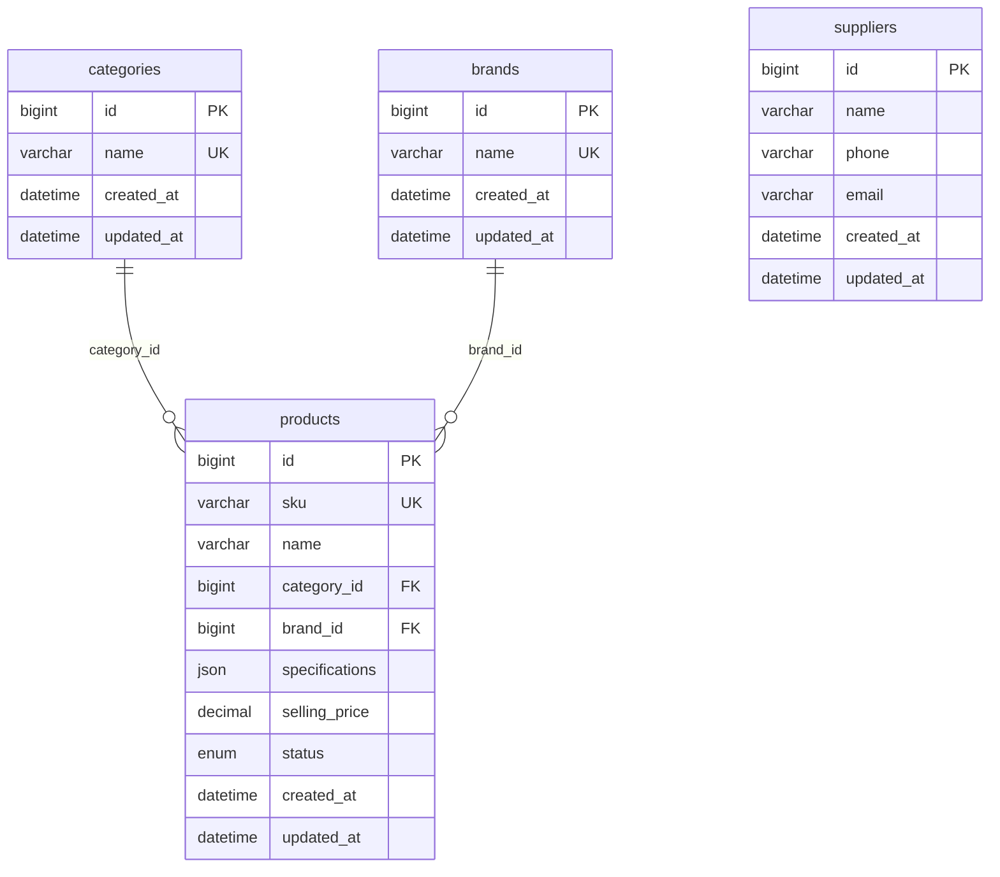
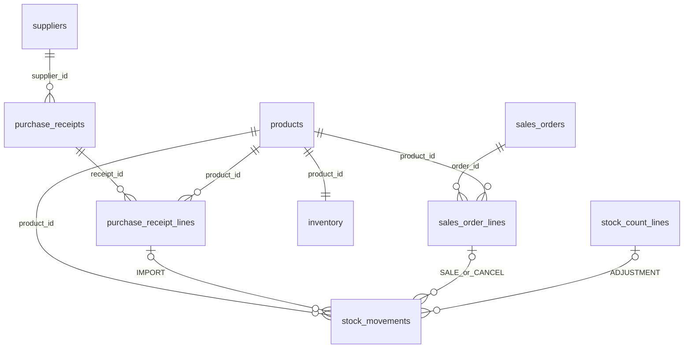

# ERD tổng hợp để review — 16/11/2026

A ghép nguồn hiện có; **chưa phải schema chung được nhóm nghiệm thu**.
Nguồn: migration [001](../../database/mysql/migrations/001_catalogs.sql),
[002](../../database/mysql/migrations/002_products_suppliers.sql),
[miền A](erd-mien-a.md), [miền B](erd-mien-b.md) và [F04 của Nam](f04-erd-mien-d.md)
tại `6729842`. F02/Nam được merge giữ lịch sử vào `integration/a-sprint2-review`.

## Phần đã có migration và kiểm thử thật

ID là BIGINT UNSIGNED, API biểu diễn bằng chuỗi để không mất chính xác. Hai FK của sản phẩm
bắt buộc và RESTRICT khi xóa; đổi tên danh mục/thương hiệu giữ nguyên ID. Đã kiểm tra
trên MySQL lab với migration thật, kể cả sản phẩm ngừng kinh doanh trong seed B.
UC01 GET sắp theo cột ID số, không sắp theo alias đã CAST thành chuỗi.
Nhà cung cấp chưa có FK chứng từ vì migration miền D chưa có.

## Phần nối miền D–E: đề xuất, chưa có DDL

Đây là quan hệ mục tiêu của F04, **không mô tả DB đang chạy**. `stock_count_lines` là tên
tạm trong nháp Nam; Hải chưa bàn giao thiết kế kiểm kê, không tự suy ra cột hoặc bảng đầu
kiểm kê. Ngưỡng tồn thấp cũng chưa có vị trí lưu đã chốt. Nháp được phép không có dòng;
khi xác nhận phải có ít nhất một dòng. Quan hệ sản phẩm–inventory 1:1 là yêu cầu dự kiến;
API tạo sản phẩm hiện chưa tạo dòng inventory.

Từ điển chi tiết giữ ở F04 để tránh hai bản quy tắc khác nhau. Stock movements dùng FK
ghép với dòng chứng từ và product_id theo nháp; chưa tuyên bố ràng buộc đã chạy trên MySQL.
Không thêm migration kho từ sơ đồ này khi D–E chưa thống nhất cơ chế chung.

## Đối chiếu và điểm cần chốt

| Điểm | Kết quả đối chiếu / việc tiếp theo | Người nhận |
|---|---|---|
| ID sản phẩm/nhà cung cấp | BIGINT UNSIGNED khớp giả định F04; tên/giá/status sản phẩm đã có | Nam rà khi viết migration |
| Danh mục/thương hiệu → sản phẩm | NOT NULL + RESTRICT đã có và test đạt; B review lựa chọn nghiệp vụ | Tuấn |
| Sản phẩm → tồn ban đầu | Chưa có inventory; cần một hàm/cơ chế tạo tồn 0 trong cùng transaction thêm sản phẩm | Nam + Hải thiết kế, Tuấn tích hợp |
| Ghi kho và chống lặp | D–E chọn chung khóa/thứ tự khóa/rollback và đầu mối hiện thực | Nam + Hải |
| Kiểm kê khi vẫn bán hàng | Nháp delta cần cách chốt thời điểm đếm; không chỉ cộng delta là đủ chứng minh đúng thực tế | Hải + Nam |
| Hủy đơn và hàng hoàn | Xác định điều kiện hàng thực sự quay lại kho, trạng thái/thời hạn hủy | A điều phối Nam + Hải |
| Doanh thu sau hủy | Chọn một phương án F03 và mốc thời gian, cung cấp ví dụ cùng kết quả mong đợi | Khánh + Nam, A điều phối |
| Sửa sai phiếu nhập | Nháp dùng kiểm kê; cần làm rõ sai số lượng khác sai giá/nhà cung cấp | Nam + Hải |
| Quyền và người thao tác | F02 có hai actor, code chỉ có token quản lý local; cần hợp đồng danh tính/phiên dùng chung | A + Khánh, các owner rà |

Chưa có đầu vào E và nhu cầu truy vấn đầy đủ từ C nên ERD tổng thể vẫn là bản review.
Không biến việc ghép bản vẽ thành xác nhận đồng thuận hoặc nhận thay thiết kế miền người khác.
