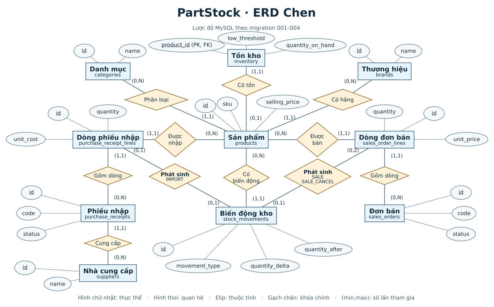

# ERD Chen tổng hợp của PartStock

Sơ đồ mô tả 10 bảng MySQL của ứng dụng theo migration
[001 — Danh mục và thương hiệu](../../database/mysql/migrations/001_catalogs.sql),
[002 — Sản phẩm và nhà cung cấp](../../database/mysql/migrations/002_products_suppliers.sql)
và [003 — Chứng từ và tồn kho](../../database/mysql/migrations/003_inventory_documents.sql).

[](erd-integrated.svg)

[Mở SVG để phóng to](erd-integrated.svg) · [Nguồn Graphviz có thể chỉnh sửa](erd-integrated.dot)

## Cách đọc sơ đồ

Hình chữ nhật là thực thể, hình thoi là quan hệ có tên và hình elip là thuộc tính tiêu biểu.
Tên bên dưới mỗi thực thể là tên bảng MySQL. Thuộc tính gạch chân là khóa chính.
Chín bảng dùng `id` tự tăng. Bảng `inventory` dùng `product_id` vừa làm khóa chính vừa
làm khóa ngoại đến `products.id`. Các khóa đều dùng kiểu `BIGINT UNSIGNED`.

Cặp `(min,max)` cạnh một thực thể cho biết một bản ghi của thực thể đó tham gia quan hệ
bao nhiêu lần. `min = 0` là tham gia tùy chọn, `min = 1` là tham gia bắt buộc và `N`
là nhiều. Ví dụ, một danh mục có thể phân loại từ 0 đến nhiều sản phẩm `(0,N)`,
còn mỗi sản phẩm bắt buộc thuộc đúng một danh mục `(1,1)`.

## Quan hệ theo ràng buộc MySQL

| Quan hệ | Thực thể thứ nhất | Thực thể thứ hai | Khóa ngoại |
|---|---|---|---|
| Phân loại | Danh mục `(0,N)` | Sản phẩm `(1,1)` | `products.category_id` → `categories.id` |
| Có hãng | Thương hiệu `(0,N)` | Sản phẩm `(1,1)` | `products.brand_id` → `brands.id` |
| Có tồn | Sản phẩm `(0,1)` | Tồn kho `(1,1)` | `inventory.product_id` → `products.id` |
| Cung cấp | Nhà cung cấp `(0,N)` | Phiếu nhập `(1,1)` | `purchase_receipts.supplier_id` → `suppliers.id` |
| Gồm dòng | Phiếu nhập `(0,N)` | Dòng phiếu nhập `(1,1)` | `purchase_receipt_lines.receipt_id` → `purchase_receipts.id` |
| Được nhập | Sản phẩm `(0,N)` | Dòng phiếu nhập `(1,1)` | `purchase_receipt_lines.product_id` → `products.id` |
| Gồm dòng | Đơn bán `(0,N)` | Dòng đơn bán `(1,1)` | `sales_order_lines.order_id` → `sales_orders.id` |
| Được bán | Sản phẩm `(0,N)` | Dòng đơn bán `(1,1)` | `sales_order_lines.product_id` → `products.id` |
| Có biến động | Sản phẩm `(0,N)` | Biến động kho `(1,1)` | `stock_movements.product_id` → `products.id` |
| Phát sinh `IMPORT` | Dòng phiếu nhập `(0,1)` | Biến động kho `(0,1)` | `stock_movements(purchase_receipt_line_id, product_id)` → `purchase_receipt_lines(id, product_id)` |
| Phát sinh `SALE` / `SALE_CANCEL` | Dòng đơn bán `(0,2)` | Biến động kho `(0,1)` | `stock_movements(sales_order_line_id, product_id)` → `sales_order_lines(id, product_id)` |

Hai khóa ngoại từ dòng chứng từ về đầu chứng từ dùng `ON DELETE CASCADE`. Các khóa
ngoại còn lại dùng `ON DELETE RESTRICT`. Mỗi sản phẩm xuất hiện tối đa một lần trong
từng phiếu nhập hoặc đơn bán nhờ `UNIQUE` trên cặp (mã định danh chứng từ, mã định danh sản phẩm).

## Tồn kho, chứng từ và nguồn biến động

- **Tồn ban đầu.** Migration 003 thêm dòng tồn bằng 0 cho các sản phẩm đã có.
  API tạo sản phẩm cũng thêm dòng tồn bằng 0 trong cùng giao dịch. Với quy trình
  của ứng dụng, mỗi sản phẩm có đúng một dòng tồn `(1,1)`. Khóa ngoại và khóa chính
  trong MySQL vẫn cho phép một sản phẩm chưa có dòng tồn `(0,1)`. [API tạo sản phẩm](../../backend/src/products.ts)
- **Dòng chứng từ.** Phiếu nhập và đơn bán ở trạng thái `DRAFT` có thể chưa có dòng và
  chưa làm đổi kho. API chỉ cho xóa chứng từ nháp và yêu cầu ít nhất một dòng khi xác nhận.
  Xác nhận ghi một `IMPORT` trên mỗi dòng phiếu nhập hoặc một `SALE` trên mỗi dòng đơn bán.
  Hủy đơn đã xác nhận ghi thêm một `SALE_CANCEL` trên mỗi dòng đơn bán.
  [API phiếu nhập](../../backend/src/purchases.ts) · [API đơn bán](../../backend/src/sales.ts)
- **Nguồn biến động.** `CHECK` yêu cầu đúng một trong ba cột nguồn có giá trị và khớp
  với loại biến động. Hai khóa ngoại ghép buộc sản phẩm trên biến động khớp sản phẩm
  của dòng chứng từ nguồn. `UNIQUE` trên từng cặp (loại biến động, dòng nguồn) giới hạn
  mỗi dòng phiếu nhập tối đa một `IMPORT` và mỗi dòng đơn bán tối đa một `SALE`
  cộng một `SALE_CANCEL`. `SALE` giảm tồn, còn `IMPORT` và `SALE_CANCEL` tăng tồn.
  [Migration 003](../../database/mysql/migrations/003_inventory_documents.sql)

## Thiết kế kiểm kê và cảnh báo còn mở

Migration 003 đã có loại `ADJUSTMENT`. Loại này yêu cầu `stock_count_line_id`, lý do
và lượng điều chỉnh khác 0. Cột `stock_count_line_id` chưa có khóa ngoại. Bảng kiểm kê,
quan hệ tới dòng kiểm kê và nơi lưu ngưỡng cảnh báo tồn thấp vẫn đang chờ thiết kế miền E.
[F03 — Quy tắc chứng từ và kho](f03-quy-tac-chung-tu-kho.md) · [F04 — Từ điển dữ liệu miền D](f04-erd-mien-d.md)

## Kết xuất SVG

Chạy từ thư mục gốc của repo với Graphviz.

```sh
neato -n2 -Tsvg docs/architecture/erd-integrated.dot -o docs/architecture/erd-integrated.svg
```
