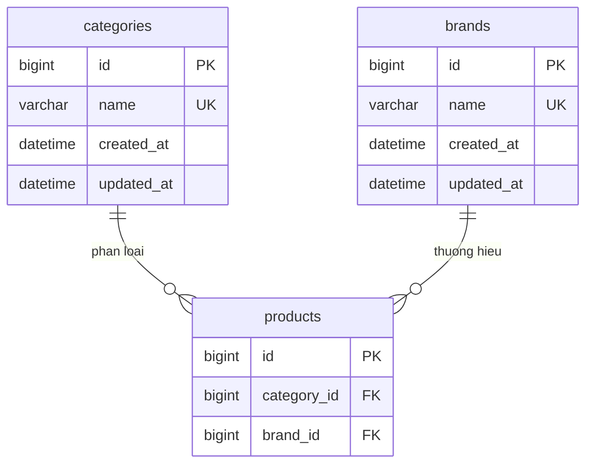

# ERD miền A — Danh mục và thương hiệu

Bản nháp 11/11/2026, A soạn, B review. Theo [thiết kế UC01](uc01-catalog-brand-design.md).
Đây là thiết kế logic để ghép ERD chung; chưa có migration hoặc bảng thực tế.

A thiết kế hai bảng `categories` (danh mục, ví dụ RAM/SSD) và `brands` (thương hiệu,
ví dụ Kingston/Samsung). Bảng `products` thuộc B, chỉ đưa các khóa liên kết vào sơ đồ này.
Hai bảng danh mục và thương hiệu độc lập, không cần liên kết trực tiếp với nhau.

Sơ đồ đề xuất mỗi sản phẩm thuộc một danh mục và một thương hiệu; mỗi danh mục/thương hiệu
có thể chưa có hoặc có nhiều sản phẩm. Tính bắt buộc của hai liên kết cần B/A xác nhận.
Nếu cho phép sản phẩm chưa có thương hiệu thì sửa quan hệ tương ứng trước khi ghép schema.

| Trường của categories/brands | Đề xuất |
|---|---|
| id | Khóa chính tự tăng, không đổi khi sửa tên |
| name | Tên bắt buộc, duy nhất trong từng bảng |
| created_at | Thời điểm tạo |
| updated_at | Thời điểm sửa gần nhất |

Các kiểu trong sơ đồ chỉ biểu diễn sơ bộ; độ dài tên, kiểu khóa cụ thể, cách so sánh tên
trùng và quy ước thời gian chốt cùng schema chung. Không tạo thêm bảng phân cấp.

Xóa danh mục/thương hiệu chưa có sản phẩm thì cho phép. Nếu đã được sản phẩm sử dụng,
khóa ngoại phải chặn xóa (RESTRICT); không xóa sản phẩm theo. Đổi tên giữ nguyên liên kết.
Việc thêm trạng thái ngừng dùng vẫn là câu hỏi mở trong thiết kế UC01.

Bàn giao cho B: đối chiếu hai FK `products.category_id` và `products.brand_id`, kiểu khóa,
tính bắt buộc và quy tắc tên. Sau review, A ghép với ERD các miền khác, B hợp nhất migration.
