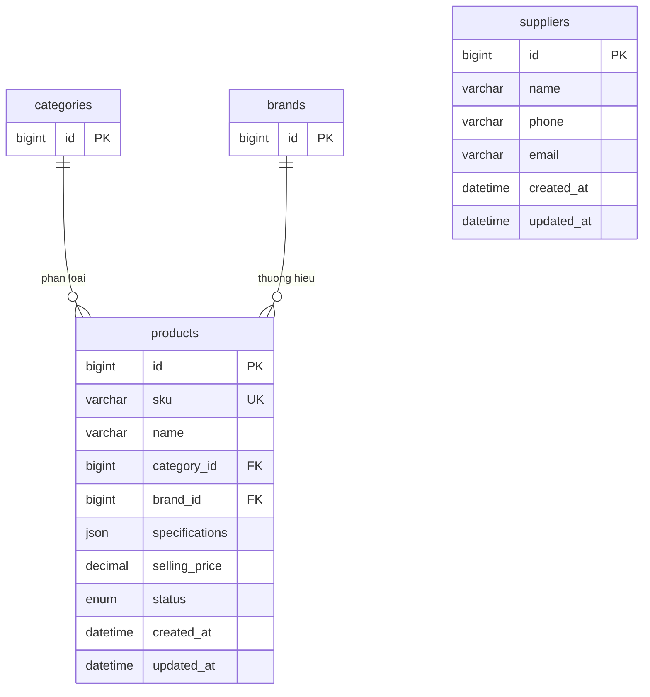

# ERD miền B — Linh kiện và nhà cung cấp

Bản nháp 13/11/2026, B soạn trên nhánh `feat/uc02-03`, chờ C review và A ghép ERD chung.
Đã kiểm tra DDL nháp và seed trên MySQL lab. Migration ứng dụng và API còn ở bước tiếp theo.
Xem [requirements.md](../requirements.md) và [erd-mien-a.md](erd-mien-a.md).

B thiết kế hai bảng `products` (linh kiện) và `suppliers` (nhà cung cấp).
Hai bảng `categories` và `brands` thuộc A, chỉ đưa khóa chính vào sơ đồ để thể hiện liên kết.

Mỗi sản phẩm thuộc một danh mục và một thương hiệu. Một danh mục hoặc thương hiệu có thể
chưa có hoặc có nhiều sản phẩm. Khi còn sản phẩm tham chiếu, kể cả sản phẩm đã ngừng kinh doanh,
hai FK chặn xóa bằng `ON DELETE RESTRICT`. Đổi tên danh mục hoặc thương hiệu giữ nguyên liên kết.

| Trường của `products` | Đề xuất |
|---|---|
| `id` | Khóa chính `BIGINT UNSIGNED` tự tăng |
| `sku` | Mã `VARCHAR(64)` bắt buộc, duy nhất, không phân biệt hoa/thường |
| `name` | Tên linh kiện `VARCHAR(150)` bắt buộc |
| `category_id`, `brand_id` | FK bắt buộc, cùng kiểu `BIGINT UNSIGNED` với khóa chính của UC01 |
| `specifications` | Thông số tùy chọn dạng JSON object. RAM có thể dùng `capacity_gb` và `speed_mt_s` |
| `selling_price` | Giá bán hiện tại bằng VND, dùng `DECIMAL(15,0)` và ràng buộc `>= 0` |
| `status` | `ENUM('ACTIVE','DISCONTINUED')`, mặc định `ACTIVE` |
| `created_at`, `updated_at` | Thời điểm tạo và sửa gần nhất, kiểu `DATETIME(3)` |

| Trường của `suppliers` | Đề xuất |
|---|---|
| `id` | Khóa chính `BIGINT UNSIGNED` tự tăng. F04 dự kiến phiếu nhập tham chiếu với `RESTRICT` |
| `name` | Tên nhà cung cấp `VARCHAR(150)` bắt buộc |
| `phone`, `email` | Liên hệ tùy chọn, lần lượt dùng `VARCHAR(32)` và `VARCHAR(254)` |
| `created_at`, `updated_at` | Thời điểm tạo và sửa gần nhất, kiểu `DATETIME(3)` |

Hai bảng dùng InnoDB và collation `utf8mb4_0900_as_ci` như UC01. Mock và API dùng chuỗi
thập phân cho ID. Giá trên dòng bán đã xác nhận được lưu riêng theo thiết kế miền D.
DDL nháp nằm ở [database/mysql/drafts/002_products_suppliers.sql](../../database/mysql/drafts/002_products_suppliers.sql).

## Phụ thuộc cần xác nhận

- Bản nháp khớp tên và kiểu của `products.id`, `sku`, `selling_price`, `status` và
  `suppliers.id` trong F04 của Nam tại `6729842`. Nam và Đạt cần xác nhận giá bán bằng 0
  và các cột tối thiểu của nhà cung cấp.
- F03 Q6 đề xuất B gọi cơ chế kho D–E để tạo dòng `inventory` với `quantity_on_hand = 0`
  trong cùng giao dịch tạo sản phẩm. Nam và Hải cần xác nhận người hiện thực và cách gọi.
  Hải có thể thêm fixture tồn khi schema kho được thống nhất.
- Nhóm còn cần chốt chính sách ngừng sử dụng nhà cung cấp và hợp đồng API.
  Xem [decisions.md](../../agent/decisions.md).

## Bàn giao

- A ghép hai FK vào ERD chung. UC01 trả ID dạng chuỗi và báo `409 RESOURCE_IN_USE`
  khi FK chặn xóa. A rà `ORDER BY id` ở UC01 để giữ thứ tự ID theo số.
- C rà khóa và dữ liệu cho UC05–06. Seed có SKU, nhiều mức giá và ca `SSD-SAM-500`
  đã ngừng kinh doanh. Seed mẫu nằm ở [database/seed/002_products_suppliers.sql](../../database/seed/002_products_suppliers.sql).
- D dùng `products.id` và `suppliers.id` cho fixture chứng từ. B và D cùng rà `rs0`
  một node và kiểm tra commit/rollback theo [setup-local-docker.md](../../setup-local-docker.md#5-khởi-tạo-mongodb-replica-set-và-user-lab).
- E cùng D xác nhận cách tạo dòng tồn ban đầu khi thêm sản phẩm.

Bản nháp chờ review. Xem thứ tự nạp dữ liệu trong [database/seed/README.md](../../database/seed/README.md#dữ-liệu-mẫu-uc0203).

## Kết quả kiểm tra ngày 13/11/2026

### Kiểm chứng thủ công của Tuấn

Tuấn nạp bốn file SQL bằng `SOURCE` trên MySQL lab 8.4.13, schema `partstock_uc0203_manual`.
Các lệnh `INSERT` ghi 0 bản ghi trùng và 0 cảnh báo. Cả 9 ca vi phạm ràng buộc trả mã lỗi dự kiến.

| Kiểm tra | Kết quả thực tế |
|---|---|
| Số bản ghi | 2 danh mục, 2 hãng, 5 sản phẩm, 2 nhà cung cấp |
| Trạng thái sản phẩm | 4 `ACTIVE`, 1 `DISCONTINUED` |
| Kingston, 500.000–1.000.000 VND | `RAM-KIN-16` (790.000 VND), `SSD-KIN-500` (990.000 VND) |
| Hai FK nhận `NULL` | 2 lỗi `1048` |
| Hai FK trỏ đến ID cha không tồn tại | 2 lỗi `1452` |
| Xóa danh mục hoặc hãng đang được tham chiếu | 2 lỗi `1451` |
| SKU trùng khác hoa/thường | 1 lỗi `1062` |
| Giá âm và thông số là mảng JSON | 2 lỗi `3819` |

Các mã lỗi lấy từ log MySQL Tuấn gửi. Tuấn xác nhận kết quả đếm, trạng thái và lọc giá.

Lượt kiểm tra tự động trên `mysql-lab` cổng `3308` cho kết quả tương tự và kiểm tra thêm
hai ca. Sản phẩm ngừng kinh doanh vẫn chặn xóa danh mục và hãng được tham chiếu. Đổi tên hãng
giữ nguyên liên kết. Schema kiểm thử tự động đã được dọn sau khi chạy.

MongoDB lab 8.0.34 trên máy Tuấn đã lên `PRIMARY` với replica set `rs0` một node.
