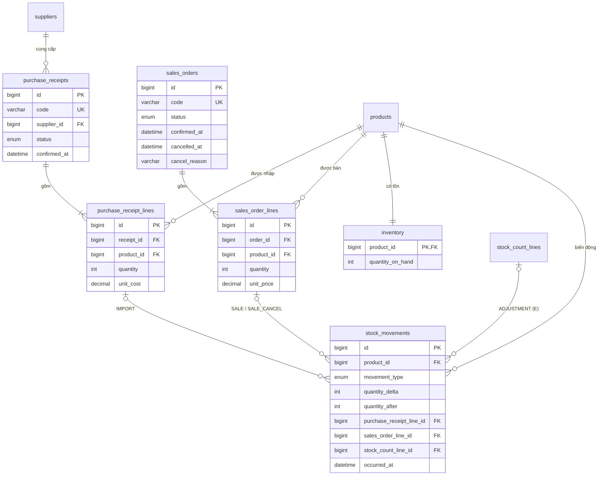

# F04 — ERD và từ điển dữ liệu miền D (nhập, bán, kho)

**Bản nháp đề xuất 10/11/2026.** D thiết kế phần phiếu nhập, đơn bán; `inventory` và
`stock_movements` dùng chung với E. Chờ E duyệt phần kho, C rà truy vấn, A hợp nhất vào ERD chung.
Chưa có migration hay DDL đã chạy. Quy tắc nghiệp vụ đi kèm: [F03](f03-quy-tac-chung-tu-kho.md).

Theo [plan ngày 11/11](../plan.md), F04 là mã tham chiếu lịch sử cho thiết kế trong gói D.
D bàn giao cấu trúc miền mình để A hợp nhất ngày 11/11, tự viết migration/API/UI và dữ liệu
tình huống; B hợp nhất migration/model/seed, E review gói D. D dùng sản phẩm/nhà cung cấp mẫu
theo cấu trúc thống nhất, không chờ CRUD của B. Phần kho dùng chung vẫn cần D–E thống nhất
giao diện và người hiện thực; bản nháp này chưa chốt thay E hoặc nhóm.

Quy ước tạm cho đến khi A chốt khi hợp nhất: tên bảng/cột tiếng Anh `snake_case`, số nhiều cho bảng;
khóa chính `id BIGINT UNSIGNED AUTO_INCREMENT`; tiền `DECIMAL(15,0)` VND; thời gian `DATETIME(3)`;
InnoDB, `utf8mb4`.

## Phụ thuộc vào bảng của A/B (giả định, phần B chưa có)

Miền D chỉ cần các cột sau. Khi B/A có thiết kế thật, đối chiếu lại tên và kiểu.

| Bảng (owner) | Cột D cần dùng | Ghi chú |
|---|---|---|
| `products` (B, UC02) | `id`, `sku` UNIQUE, `name`, `selling_price DECIMAL(15,0)`, `status ENUM('ACTIVE','DISCONTINUED')` | Giá hiện hành để chốt vào dòng bán; trạng thái chặn nhập/bán sản phẩm ngừng kinh doanh |
| `suppliers` (B, UC03) | `id`, `name` | Phiếu nhập tham chiếu nhà cung cấp |
| Bảng kiểm kê (E, UC12) | `id` của dòng kiểm kê | Tên bảng chưa có; tạm gọi `stock_count_lines` |

## Sơ đồ



`|{` nghĩa là chứng từ cần ít nhất một dòng khi **xác nhận**; nháp được phép rỗng, backend kiểm tra
lúc xác nhận (F03). Mỗi dòng chứng từ có 0 biến động khi nháp, 1 khi xác nhận, 2 với dòng đơn đã hủy.

## Từ điển dữ liệu

### `purchase_receipts` — phiếu nhập (UC04)

| Cột | Kiểu | Null | Ràng buộc / ý nghĩa |
|---|---|---|---|
| `id` | BIGINT UNSIGNED | Không | PK |
| `code` | VARCHAR(30) | Không | UNIQUE; mã hiển thị, backend sinh (ví dụ `PN-20261113-0001`, F06 chốt định dạng) |
| `supplier_id` | BIGINT UNSIGNED | Không | FK → `suppliers.id`, RESTRICT |
| `status` | ENUM('DRAFT','CONFIRMED') | Không | Mặc định `DRAFT` |
| `note` | VARCHAR(500) | Có | Ghi chú |
| `created_at` | DATETIME(3) | Không | Mặc định thời điểm tạo |
| `updated_at` | DATETIME(3) | Không | Tự cập nhật khi sửa |
| `confirmed_at` | DATETIME(3) | Có | CHECK: `(status='DRAFT' AND confirmed_at IS NULL) OR (status='CONFIRMED' AND confirmed_at IS NOT NULL)` |

Index: `(status, confirmed_at)` cho tra cứu lịch sử nhập theo thời gian.

### `purchase_receipt_lines` — dòng nhập

| Cột | Kiểu | Null | Ràng buộc / ý nghĩa |
|---|---|---|---|
| `id` | BIGINT UNSIGNED | Không | PK |
| `receipt_id` | BIGINT UNSIGNED | Không | FK → `purchase_receipts.id`, ON DELETE CASCADE (chỉ xảy ra với nháp, xem bên dưới) |
| `product_id` | BIGINT UNSIGNED | Không | FK → `products.id`, RESTRICT |
| `quantity` | INT | Không | CHECK `quantity > 0` |
| `unit_cost` | DECIMAL(15,0) | Không | CHECK `unit_cost >= 0`; giá nhập do nhân viên nhập |

UNIQUE `(receipt_id, product_id)`; UNIQUE `(id, product_id)` để làm đích FK ghép từ `stock_movements`.

### `sales_orders` — đơn bán (UC07, UC08)

| Cột | Kiểu | Null | Ràng buộc / ý nghĩa |
|---|---|---|---|
| `id` | BIGINT UNSIGNED | Không | PK |
| `code` | VARCHAR(30) | Không | UNIQUE; ví dụ `DB-20261113-0001` |
| `status` | ENUM('DRAFT','CONFIRMED','CANCELLED') | Không | Mặc định `DRAFT` |
| `customer_name` | VARCHAR(150) | Có | Tùy chọn (F03 Q7) |
| `note` | VARCHAR(500) | Có | |
| `created_at`, `updated_at` | DATETIME(3) | Không | |
| `confirmed_at` | DATETIME(3) | Có | Mốc tính doanh thu |
| `cancelled_at` | DATETIME(3) | Có | |
| `cancel_reason` | VARCHAR(500) | Có | |

CHECK nhất quán trạng thái – mốc thời gian:

```text
   (status='DRAFT'     AND confirmed_at IS NULL     AND cancelled_at IS NULL     AND cancel_reason IS NULL)
OR (status='CONFIRMED' AND confirmed_at IS NOT NULL AND cancelled_at IS NULL     AND cancel_reason IS NULL)
OR (status='CANCELLED' AND confirmed_at IS NOT NULL AND cancelled_at IS NOT NULL AND cancel_reason IS NOT NULL
    AND cancelled_at >= confirmed_at)
```

Index: `(status, confirmed_at)` cho doanh thu theo thời gian (UC11) và lịch sử bán.

### `sales_order_lines` — dòng bán

| Cột | Kiểu | Null | Ràng buộc / ý nghĩa |
|---|---|---|---|
| `id` | BIGINT UNSIGNED | Không | PK |
| `order_id` | BIGINT UNSIGNED | Không | FK → `sales_orders.id`, ON DELETE CASCADE |
| `product_id` | BIGINT UNSIGNED | Không | FK → `products.id`, RESTRICT |
| `quantity` | INT | Không | CHECK `quantity > 0` |
| `unit_price` | DECIMAL(15,0) | Không | CHECK `unit_price >= 0`; nháp: giá tạm lúc thêm dòng; ghi lại từ `products.selling_price` khi xác nhận rồi giữ cố định |

UNIQUE `(order_id, product_id)`; UNIQUE `(id, product_id)`.

### `inventory` — tồn hiện tại (D–E)

| Cột | Kiểu | Null | Ràng buộc / ý nghĩa |
|---|---|---|---|
| `product_id` | BIGINT UNSIGNED | Không | PK, FK → `products.id`, RESTRICT; tạo cùng sản phẩm với giá trị 0 (F03 Q6) |
| `quantity_on_hand` | INT | Không | Mặc định 0; CHECK `quantity_on_hand >= 0` (bất biến I1, lớp chặn cuối nếu backend lỗi) |
| `updated_at` | DATETIME(3) | Không | |

Ngưỡng cảnh báo tồn thấp (UC10) là phần của E; có thể thêm cột ở đây hoặc ở `products`, E–B chọn.
Lọc theo tồn (UC06 của C) join `products` với `inventory` theo khóa chính, không cần index thêm;
C cân nhắc index `quantity_on_hand` theo kết quả LAB-B/LAB-C.

### `stock_movements` — sổ biến động kho (D–E)

Chỉ thêm, không sửa/xóa. Nguồn dữ liệu cho UC09 (lịch sử nhập/xuất/tồn).

| Cột | Kiểu | Null | Ràng buộc / ý nghĩa |
|---|---|---|---|
| `id` | BIGINT UNSIGNED | Không | PK; tăng dần theo thứ tự ghi |
| `product_id` | BIGINT UNSIGNED | Không | FK → `products.id`, RESTRICT |
| `movement_type` | ENUM('IMPORT','SALE','SALE_CANCEL','ADJUSTMENT') | Không | |
| `quantity_delta` | INT | Không | Có dấu: nhập/hoàn dương, bán âm |
| `quantity_after` | INT | Không | CHECK `>= 0`; tồn ngay sau biến động |
| `purchase_receipt_line_id` | BIGINT UNSIGNED | Có | FK ghép `(purchase_receipt_line_id, product_id)` → `purchase_receipt_lines(id, product_id)` |
| `sales_order_line_id` | BIGINT UNSIGNED | Có | FK ghép `(sales_order_line_id, product_id)` → `sales_order_lines(id, product_id)` |
| `stock_count_line_id` | BIGINT UNSIGNED | Có | FK tới bảng kiểm kê của E, thêm khi E có bảng |
| `reason` | VARCHAR(500) | Có | Bắt buộc với `ADJUSTMENT` |
| `occurred_at` | DATETIME(3) | Không | Thời điểm xác nhận chứng từ nguồn |

CHECK loại – dấu – nguồn (đúng một tham chiếu khác NULL, khớp loại):

```text
   (movement_type='IMPORT'      AND quantity_delta > 0  AND purchase_receipt_line_id IS NOT NULL
                                AND sales_order_line_id IS NULL AND stock_count_line_id IS NULL)
OR (movement_type='SALE'        AND quantity_delta < 0  AND sales_order_line_id IS NOT NULL
                                AND purchase_receipt_line_id IS NULL AND stock_count_line_id IS NULL)
OR (movement_type='SALE_CANCEL' AND quantity_delta > 0  AND sales_order_line_id IS NOT NULL
                                AND purchase_receipt_line_id IS NULL AND stock_count_line_id IS NULL)
OR (movement_type='ADJUSTMENT'  AND quantity_delta <> 0 AND stock_count_line_id IS NOT NULL AND reason IS NOT NULL
                                AND purchase_receipt_line_id IS NULL AND sales_order_line_id IS NULL)
```

Chống ghi lặp (lớp 2 trong F03):

- UNIQUE `(movement_type, purchase_receipt_line_id)`
- UNIQUE `(movement_type, sales_order_line_id)` — cho phép đúng một `SALE` và một `SALE_CANCEL` mỗi dòng
- UNIQUE `(movement_type, stock_count_line_id)`

MySQL cho phép nhiều NULL trong UNIQUE, nên dòng thuộc loại khác không va chạm nhau.
Index `(product_id, occurred_at, id)` cho lịch sử theo sản phẩm và thời gian (UC09).

FK ghép `(line_id, product_id)` bảo đảm biến động ghi đúng sản phẩm của dòng nguồn, không chỉ đúng dòng.

## Ghi chú cho F07 (migration) — cần kiểm chứng khi viết

- MySQL chỉ thực thi CHECK từ 8.0.16; môi trường hiện tại là 8.4.13. MySQL cấm cột dùng trong CHECK
  đồng thời là cột FK có hành động `ON DELETE/ON UPDATE CASCADE/SET NULL`. Các FK của `stock_movements`
  để mặc định RESTRICT nên dự kiến hợp lệ, nhưng chưa chạy thử; phải kiểm tra lúc viết migration.
- Thứ tự tạo: `products`, `suppliers` (B) → `purchase_receipts` → `purchase_receipt_lines` →
  `sales_orders` → `sales_order_lines` → `inventory` → `stock_movements` (FK kiểm kê thêm sau khi E có bảng).
- Ràng buộc không biểu diễn được bằng CHECK (liên bảng) do backend bảo đảm trong transaction và
  được kiểm bằng truy vấn bất biến I2–I5 trong F03: chứng từ có ít nhất một dòng khi xác nhận;
  dòng chứng từ không đổi sau xác nhận; tồn bằng tổng biến động.
- Có thể thêm trigger chặn `UPDATE/DELETE` trên `stock_movements` và trên dòng của chứng từ đã xác nhận;
  để nhóm cân nhắc vì trigger làm luồng khó theo dõi hơn. Quyền DB của user app là một phương án khác.

## Mapping sang 8 dạng thao tác (C đối chiếu)

| Dạng | Ví dụ trên miền D |
|---|---|
| insert | Tạo phiếu nhập/đơn bán nháp và dòng |
| delete | Xóa đơn/phiếu nháp (cascade dòng) |
| update | Xác nhận chứng từ, trừ/cộng tồn có điều kiện |
| join | Đơn bán – dòng bán – sản phẩm |
| aggregate | Doanh thu theo ngày từ `sales_orders` + `sales_order_lines` |
