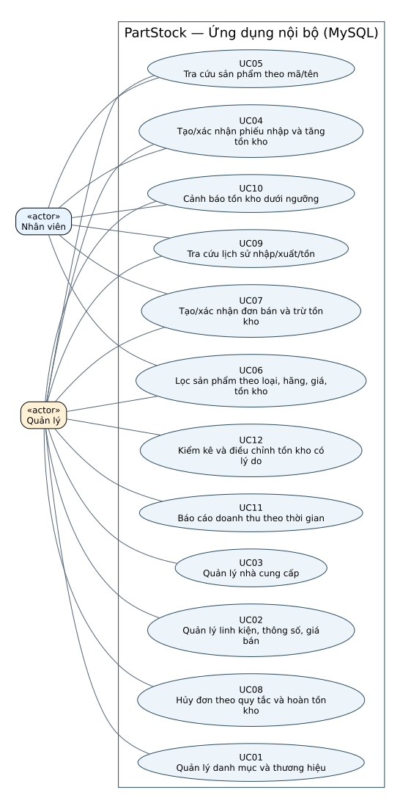

# F02 — Use case PartStock

Ngày: 10/11/2026. **Bản nháp thiết kế, chờ C review và owner góp ý; chưa nghiệm thu F02.**
A hợp nhất. Các luồng dưới đây là đề xuất đặc tả theo yêu cầu, không phải code hoặc bằng chứng demo.

## Nguồn và ranh giới

[Yêu cầu](../requirements.md) xác định phạm vi và 12 UC; [ownership](../ownership.md)
xác định owner; [kế hoạch](../plan.md) giao F02 cho A, C review;
[sổ quyết định](../../agent/decisions.md) ghi các quy tắc còn mở.
Một cửa hàng, một kho; ứng dụng nội bộ dùng MySQL. MongoDB phục vụ lab riêng.
Không thêm online, giao hàng, thanh toán trực tuyến, đa chi nhánh hoặc use case đăng nhập để đủ số lượng.

## Actor và cách đọc

Hai actor **Nhân viên** và **Quản lý** được A duyệt trong phiên làm việc ngày 10/11/2026.
Nhân viên thực hiện UC04, UC05, UC06, UC07, UC09 và UC10.
Quản lý thực hiện toàn bộ 12 UC, gồm các quyền bổ sung UC01, UC02, UC03, UC08, UC11 và UC12.
Nhân viên được chọn sản phẩm/nhà cung cấp đã có khi nhập/bán; việc này không cấp quyền quản lý UC01–UC03.
A–E là owner phát triển, không phải actor. Nhà cung cấp/khách hàng không trực tiếp dùng ứng dụng trong phạm vi hiện tại.
Phân công actor đã được A duyệt; C/owner vẫn cần review đặc tả. Chưa ghi nhận đồng thuận toàn nhóm hoặc phân quyền đã được triển khai.



[Nguồn Graphviz](use-case-diagram.dot). Actor dùng ký hiệu classifier «actor», UC là ellipse,
khung PartStock là ranh giới hệ thống. Đường nối biểu thị tương tác, không biểu thị trình tự.
Không dùng include/extend khi chưa có quan hệ hành vi cần thể hiện.

## Bảng bao phủ

| ID   | Tên                                        | Owner phát triển | Actor sử dụng          | Đặc tả        |
| ---- | ------------------------------------------ | ---------------- | ---------------------- | ------------- |
| UC01 | Quản lý danh mục và thương hiệu            | A                | Quản lý | [UC01](#uc01) |
| UC02 | Quản lý linh kiện, thông số, giá bán       | B                | Quản lý | [UC02](#uc02) |
| UC03 | Quản lý nhà cung cấp                       | B                | Quản lý | [UC03](#uc03) |
| UC04 | Tạo/xác nhận phiếu nhập và tăng tồn kho    | D                | Nhân viên, Quản lý | [UC04](#uc04) |
| UC05 | Tra cứu sản phẩm theo mã/tên               | C                | Nhân viên, Quản lý | [UC05](#uc05) |
| UC06 | Lọc sản phẩm theo loại, hãng, giá, tồn kho | C                | Nhân viên, Quản lý | [UC06](#uc06) |
| UC07 | Tạo/xác nhận đơn bán và trừ tồn kho        | D                | Nhân viên, Quản lý | [UC07](#uc07) |
| UC08 | Hủy đơn theo quy tắc và hoàn tồn kho       | D                | Quản lý | [UC08](#uc08) |
| UC09 | Tra cứu lịch sử nhập/xuất/tồn              | E                | Nhân viên, Quản lý | [UC09](#uc09) |
| UC10 | Cảnh báo tồn kho dưới ngưỡng               | E                | Nhân viên, Quản lý | [UC10](#uc10) |
| UC11 | Báo cáo doanh thu theo thời gian           | C                | Quản lý | [UC11](#uc11) |
| UC12 | Kiểm kê và điều chỉnh tồn kho có lý do     | E                | Quản lý | [UC12](#uc12) |

Mục tiêu/kích hoạt ghi trong từng đặc tả.

## Đặc tả

<a id="uc01"></a>

### UC01 — Quản lý danh mục và thương hiệu

- **Owner:** A. **Actor:** Quản lý.
- **Mục tiêu/kích hoạt:** Người dùng muốn xem hoặc cập nhật danh mục/thương hiệu.
- **Tiền điều kiện:** Có thông tin danh mục hoặc thương hiệu cần quản lý.

**Luồng chính:**

1. Mở danh sách danh mục hoặc thương hiệu.
2. Chọn xem, thêm, sửa hoặc yêu cầu xóa một mục; nếu chỉ xem, hiển thị thông tin và kết thúc, dữ liệu không đổi.
3. Với thêm/sửa, nhập thông tin và gửi; với xóa, gửi yêu cầu xóa mục đã chọn.
4. Hệ thống kiểm tra tính hợp lệ và tham chiếu, lưu thay đổi được phép rồi hiển thị kết quả.

**Nhánh thay thế/ngoại lệ:**

- Thông tin không hợp lệ: báo lỗi, giữ dữ liệu đã lưu.
- Mục đang được tham chiếu: không xóa làm mất liên kết; cách ngừng sử dụng chờ Q01.

**Hậu điều kiện thành công:** Xem trả thông tin, dữ liệu không đổi; thêm/sửa/xóa hợp lệ cập nhật mục tương ứng, không tác động tồn kho.

**Hậu điều kiện thất bại:** thao tác bị từ chối hoặc lỗi không để lại thay đổi một phần; tra cứu không thay đổi dữ liệu.

**Quy tắc nguồn:** quy tắc nghiệp vụ trong [requirements](../requirements.md); câu hỏi còn mở: Q01.

<a id="uc02"></a>

### UC02 — Quản lý linh kiện, thông số, giá bán

- **Owner:** B. **Actor:** Quản lý.
- **Mục tiêu/kích hoạt:** Người dùng muốn quản lý thông tin sản phẩm.
- **Tiền điều kiện:** Danh mục/thương hiệu cần dùng đã có; xác định sản phẩm khi sửa.

**Luồng chính:**

1. Mở danh sách linh kiện và chọn thao tác.
2. Nhập hoặc sửa thông tin, thông số, giá bán và liên kết liên quan.
3. Hệ thống kiểm tra dữ liệu và lưu thay đổi hợp lệ.
4. Hiển thị sản phẩm sau cập nhật.

**Nhánh thay thế/ngoại lệ:**

- Dữ liệu không hợp lệ hoặc tham chiếu không tồn tại: báo lỗi, không lưu thay đổi.
- Sản phẩm có lịch sử: dùng ngừng kinh doanh thay xóa lịch sử.
- Đổi giá bán hiện tại không sửa giá trên dòng giao dịch cũ.

**Hậu điều kiện thành công:** Thông tin/giá hiện tại được lưu; không tự thay đổi tồn hoặc giao dịch quá khứ.

**Hậu điều kiện thất bại:** thao tác bị từ chối hoặc lỗi không để lại thay đổi một phần; tra cứu không thay đổi dữ liệu.

**Quy tắc nguồn:** quy tắc nghiệp vụ trong [requirements](../requirements.md); câu hỏi còn mở: Q01, Q02.

<a id="uc03"></a>

### UC03 — Quản lý nhà cung cấp

- **Owner:** B. **Actor:** Quản lý.
- **Mục tiêu/kích hoạt:** Người dùng muốn xem hoặc cập nhật nhà cung cấp.
- **Tiền điều kiện:** Xác định nhà cung cấp nếu sửa/xóa.

**Luồng chính:**

1. Mở danh sách nhà cung cấp.
2. Chọn xem, thêm, sửa hoặc yêu cầu xóa; nếu chỉ xem, hiển thị thông tin và kết thúc, dữ liệu không đổi.
3. Với thêm/sửa, nhập thông tin và gửi; với xóa, gửi yêu cầu xóa nhà cung cấp đã chọn.
4. Hệ thống kiểm tra hợp lệ/tham chiếu, thực hiện thay đổi được phép và trả kết quả.

**Nhánh thay thế/ngoại lệ:**

- Thông tin không hợp lệ: báo lỗi, không lưu.
- Nhà cung cấp có chứng từ: không xóa phá tham chiếu; chính sách ngừng sử dụng chờ Q01.

**Hậu điều kiện thành công:** Xem trả thông tin, dữ liệu không đổi; thay đổi hợp lệ được lưu, chứng từ cũ được bảo toàn.

**Hậu điều kiện thất bại:** thao tác bị từ chối hoặc lỗi không để lại thay đổi một phần; tra cứu không thay đổi dữ liệu.

**Quy tắc nguồn:** quy tắc nghiệp vụ trong [requirements](../requirements.md); câu hỏi còn mở: Q01.

<a id="uc04"></a>

### UC04 — Tạo/xác nhận phiếu nhập và tăng tồn kho

- **Owner:** D. **Actor:** Nhân viên hoặc Quản lý.
- **Mục tiêu/kích hoạt:** Người dùng nhận hàng và muốn ghi nhận nhập kho.
- **Tiền điều kiện:** Có sản phẩm/nhà cung cấp phù hợp; khi xác nhận phải có phiếu nháp hợp lệ.

**Luồng chính:**

1. Chọn nhà cung cấp và thêm các dòng sản phẩm, số lượng, thông tin nhập.
2. Lưu phiếu nháp; hệ thống chưa tăng tồn.
3. Người dùng yêu cầu xác nhận phiếu.
4. Hệ thống kiểm tra dữ liệu và trạng thái hiện tại.
5. Nếu hợp lệ, cập nhật chứng từ, tăng tồn và ghi biến động nhất quán; hiển thị kết quả.

**Nhánh thay thế/ngoại lệ:**

- Xóa phiếu nhập nháp: kiểm tra vẫn là nháp chưa tác động kho; xóa chứng từ/dòng nháp hợp lệ, tồn và biến động giữ nguyên. Nếu đã xác nhận hoặc bị chuyển trạng thái đồng thời, từ chối xóa; không xóa phá lịch sử.
- Dòng hàng không hợp lệ: từ chối xác nhận và nêu lỗi.
- Xác nhận lặp/đồng thời: không tăng tồn thêm cho cùng lần xác nhận.
- Lỗi giữa chừng: không để chứng từ, tồn và biến động chỉ cập nhật một phần.

**Hậu điều kiện thành công:** Nháp không đổi tồn; xác nhận thành công tăng tồn đúng một lần và có lịch sử khớp.

**Hậu điều kiện thất bại:** thao tác bị từ chối hoặc lỗi không để lại thay đổi một phần; tra cứu không thay đổi dữ liệu.

**Quy tắc nguồn:** quy tắc nghiệp vụ trong [requirements](../requirements.md); câu hỏi còn mở: Q02, Q03.

<a id="uc05"></a>

### UC05 — Tra cứu sản phẩm theo mã/tên

- **Owner:** C. **Actor:** Nhân viên hoặc Quản lý.
- **Mục tiêu/kích hoạt:** Người dùng cần tìm sản phẩm.
- **Tiền điều kiện:** Có dữ liệu sản phẩm để tra cứu; danh sách rỗng vẫn là kết quả hợp lệ.

**Luồng chính:**

1. Mở chức năng tra cứu.
2. Nhập mã hoặc tên sản phẩm và gửi tìm kiếm.
3. Hệ thống tra cứu và hiển thị các sản phẩm phù hợp.

**Nhánh thay thế/ngoại lệ:**

- Không có sản phẩm phù hợp: hiển thị kết quả rỗng.
- Từ khóa rỗng hoặc cách so khớp: xử lý theo quy ước cần chốt Q04.

**Hậu điều kiện thành công:** Hiển thị kết quả; không thay đổi dữ liệu.

**Hậu điều kiện thất bại:** thao tác bị từ chối hoặc lỗi không để lại thay đổi một phần; tra cứu không thay đổi dữ liệu.

**Quy tắc nguồn:** quy tắc nghiệp vụ trong [requirements](../requirements.md); câu hỏi còn mở: Q04.

<a id="uc06"></a>

### UC06 — Lọc sản phẩm theo loại, hãng, giá, tồn kho

- **Owner:** C. **Actor:** Nhân viên hoặc Quản lý.
- **Mục tiêu/kích hoạt:** Người dùng muốn thu hẹp danh sách sản phẩm.
- **Tiền điều kiện:** Các tiêu chí lọc được người dùng lựa chọn.

**Luồng chính:**

1. Mở danh sách sản phẩm và chọn loại/hãng/khoảng giá/điều kiện tồn.
2. Gửi bộ điều kiện kết hợp.
3. Hệ thống kiểm tra đầu vào, áp dụng các điều kiện và hiển thị kết quả.

**Nhánh thay thế/ngoại lệ:**

- Khoảng giá không hợp lệ, như giá tối thiểu lớn hơn tối đa: báo lỗi để sửa.
- Không có kết quả: hiển thị danh sách rỗng.
- Bỏ một tiêu chí: không áp dụng tiêu chí đó; cách biểu diễn điều kiện tồn chờ Q04.

**Hậu điều kiện thành công:** Kết quả phù hợp các tiêu chí hợp lệ; dữ liệu không đổi.

**Hậu điều kiện thất bại:** thao tác bị từ chối hoặc lỗi không để lại thay đổi một phần; tra cứu không thay đổi dữ liệu.

**Quy tắc nguồn:** quy tắc nghiệp vụ trong [requirements](../requirements.md); câu hỏi còn mở: Q04.

<a id="uc07"></a>

### UC07 — Tạo/xác nhận đơn bán và trừ tồn kho

- **Owner:** D. **Actor:** Nhân viên hoặc Quản lý.
- **Mục tiêu/kích hoạt:** Người dùng muốn ghi nhận bán hàng.
- **Tiền điều kiện:** Có sản phẩm có thể bán; khi xác nhận phải có đơn nháp hợp lệ.

**Luồng chính:**

1. Chọn sản phẩm, số lượng và thông tin giao dịch cần thiết.
2. Lưu đơn nháp; hệ thống chưa trừ tồn.
3. Người dùng yêu cầu xác nhận đơn.
4. Hệ thống kiểm tra trạng thái, dữ liệu và tồn tại thời điểm xác nhận.
5. Nếu đủ tồn, lưu giá giao dịch, cập nhật đơn, trừ tồn và ghi biến động nhất quán.

**Nhánh thay thế/ngoại lệ:**

- Xóa đơn bán nháp: kiểm tra vẫn là nháp chưa tác động kho; xóa chứng từ/dòng nháp hợp lệ, tồn và biến động giữ nguyên. Nếu đã xác nhận hoặc bị chuyển trạng thái đồng thời, từ chối xóa; không xóa phá lịch sử.
- Thiếu tồn: từ chối xác nhận, không trừ tồn hay ghi nhận bán một phần.
- Xác nhận lặp/đồng thời: cùng đơn không bị trừ tồn thêm.
- Giá thay đổi khi đơn còn nháp: thời điểm chốt giá chờ Q02.
- Lỗi giữa chừng: không để đơn, tồn và biến động cập nhật một phần.

**Hậu điều kiện thành công:** Nháp không đổi tồn; bán thành công trừ đúng lượng, tồn không âm; dòng bán giữ giá giao dịch.

**Hậu điều kiện thất bại:** thao tác bị từ chối hoặc lỗi không để lại thay đổi một phần; tra cứu không thay đổi dữ liệu.

**Quy tắc nguồn:** quy tắc nghiệp vụ trong [requirements](../requirements.md); câu hỏi còn mở: Q02, Q03.

<a id="uc08"></a>

### UC08 — Hủy đơn theo quy tắc và hoàn tồn kho

- **Owner:** D. **Actor:** Quản lý.
- **Mục tiêu/kích hoạt:** Người dùng yêu cầu hủy đơn bán.
- **Tiền điều kiện:** Đơn tồn tại; điều kiện trạng thái cho phép hủy chờ F03 (Q03).

**Luồng chính:**

1. Mở đơn và yêu cầu hủy.
2. Hệ thống kiểm tra trạng thái hiện tại theo quy tắc đã được thống nhất.
3. Nếu được phép, cập nhật trạng thái và hoàn tồn/ghi biến động nếu đơn đã tác động kho.
4. Hiển thị kết quả và lịch sử liên quan.

**Nhánh thay thế/ngoại lệ:**

- Trạng thái không được hủy: từ chối, dữ liệu giữ nguyên.
- Hủy lặp/đồng thời: không hoàn tồn thêm cho cùng lần hủy.
- Đơn chưa từng trừ tồn: không phát sinh tăng tồn do hủy.
- Lỗi giữa chừng: hủy và tác động kho không được lưu một phần.

**Hậu điều kiện thành công:** Lần hủy hợp lệ có tác động kho nhất quán, không hoàn lặp; chi tiết phụ thuộc Q03.

**Hậu điều kiện thất bại:** thao tác bị từ chối hoặc lỗi không để lại thay đổi một phần; tra cứu không thay đổi dữ liệu.

**Quy tắc nguồn:** quy tắc nghiệp vụ trong [requirements](../requirements.md); câu hỏi còn mở: Q03, Q06.

<a id="uc09"></a>

### UC09 — Tra cứu lịch sử nhập/xuất/tồn

- **Owner:** E. **Actor:** Nhân viên hoặc Quản lý.
- **Mục tiêu/kích hoạt:** Người dùng muốn truy vết tình hình và biến động kho.
- **Tiền điều kiện:** Có hoặc chưa có phát sinh kho trong phạm vi tra cứu.

**Luồng chính:**

1. Mở lịch sử nhập/xuất/tồn.
2. Chọn sản phẩm/phạm vi tra cứu phù hợp.
3. Hệ thống kiểm tra điều kiện và hiển thị tồn, biến động cùng tham chiếu chứng từ liên quan.
4. Người dùng đối chiếu biến động với dữ liệu nguồn.

**Nhánh thay thế/ngoại lệ:**

- Không có phát sinh: hiển thị kết quả rỗng hoặc tồn không đổi phù hợp dữ liệu.
- Điều kiện không hợp lệ: yêu cầu sửa; cách tính tồn đầu/cuối kỳ chờ Q05.

**Hậu điều kiện thành công:** Kết quả truy vết được nguồn, nhất quán tồn và biến động; không sửa dữ liệu.

**Hậu điều kiện thất bại:** thao tác bị từ chối hoặc lỗi không để lại thay đổi một phần; tra cứu không thay đổi dữ liệu.

**Quy tắc nguồn:** quy tắc nghiệp vụ trong [requirements](../requirements.md); câu hỏi còn mở: Q05.

<a id="uc10"></a>

### UC10 — Cảnh báo tồn kho dưới ngưỡng

- **Owner:** E. **Actor:** Nhân viên hoặc Quản lý.
- **Mục tiêu/kích hoạt:** Người dùng muốn biết sản phẩm cần bổ sung tồn.
- **Tiền điều kiện:** Có ngưỡng hợp lệ theo quy tắc sẽ được thống nhất (Q05).

**Luồng chính:**

1. Mở chức năng cảnh báo tồn thấp.
2. Hệ thống đối chiếu tồn với ngưỡng áp dụng.
3. Hiển thị sản phẩm có tồn dưới ngưỡng cùng tồn và ngưỡng để đối chiếu.

**Nhánh thay thế/ngoại lệ:**

- Không có sản phẩm dưới ngưỡng: hiển thị không có cảnh báo.
- Chưa có ngưỡng hợp lệ: thể hiện thiếu cấu hình; nguồn/mặc định ngưỡng chờ Q05.

**Hậu điều kiện thành công:** Hiển thị cảnh báo theo dữ liệu tồn; không tự thay đổi kho.

**Hậu điều kiện thất bại:** thao tác bị từ chối hoặc lỗi không để lại thay đổi một phần; tra cứu không thay đổi dữ liệu.

**Quy tắc nguồn:** quy tắc nghiệp vụ trong [requirements](../requirements.md); câu hỏi còn mở: Q05.

<a id="uc11"></a>

### UC11 — Báo cáo doanh thu theo thời gian

- **Owner:** C. **Actor:** Quản lý.
- **Mục tiêu/kích hoạt:** Người dùng muốn xem doanh thu trong một khoảng thời gian.
- **Tiền điều kiện:** Có quy tắc về đơn được tính, mốc thời gian và xử lý hủy sau F03 (Q06).

**Luồng chính:**

1. Mở báo cáo và chọn khoảng thời gian.
2. Hệ thống kiểm tra khoảng thời gian.
3. Tổng hợp giao dịch đủ điều kiện theo quy tắc đã chốt, sử dụng giá giao dịch đã lưu.
4. Hiển thị kết quả và khoảng thời gian áp dụng.

**Nhánh thay thế/ngoại lệ:**

- Khoảng thời gian không hợp lệ: báo lỗi, không trả số liệu gây hiểu nhầm.
- Không có giao dịch đủ điều kiện: tổng doanh thu bằng 0.
- Quy tắc sau hủy/mốc ngày chưa chốt: đặc tả chưa xác định kết quả số cho các ca này.

**Hậu điều kiện thành công:** Báo cáo khớp giao dịch đủ điều kiện và giá lịch sử; không sửa dữ liệu.

**Hậu điều kiện thất bại:** thao tác bị từ chối hoặc lỗi không để lại thay đổi một phần; tra cứu không thay đổi dữ liệu.

**Quy tắc nguồn:** quy tắc nghiệp vụ trong [requirements](../requirements.md); câu hỏi còn mở: Q06.

<a id="uc12"></a>

### UC12 — Kiểm kê và điều chỉnh tồn kho có lý do

- **Owner:** E. **Actor:** Quản lý.
- **Mục tiêu/kích hoạt:** Người dùng muốn ghi nhận số lượng thực tế và xử lý chênh lệch.
- **Tiền điều kiện:** Xác định sản phẩm và số lượng kiểm đếm; áp dụng quy tắc đồng thời sau F03 (Q07).

**Luồng chính:**

1. Mở chức năng kiểm kê, ghi nhận số lượng thực tế.
2. Hệ thống hiển thị số liệu đối chiếu/chênh lệch theo quy tắc kiểm kê.
3. Người dùng nhập lý do và xác nhận điều chỉnh.
4. Hệ thống kiểm tra dữ liệu/trạng thái và điều kiện đồng thời.
5. Lưu kết quả kiểm kê, cập nhật tồn và biến động có tham chiếu/lý do nhất quán.

**Nhánh thay thế/ngoại lệ:**

- Thiếu lý do hoặc số lượng không hợp lệ: từ chối điều chỉnh.
- Có giao dịch đồng thời: hành vi chờ Q07, không ghi đè âm thầm gây mất cập nhật.
- Lặp xác nhận/lỗi giữa chừng: không ghi biến động lặp hoặc cập nhật một phần.

**Hậu điều kiện thành công:** Điều chỉnh hợp lệ có lý do, truy vết và tồn khớp lịch sử; không âm theo quy tắc đã chốt.

**Hậu điều kiện thất bại:** thao tác bị từ chối hoặc lỗi không để lại thay đổi một phần; tra cứu không thay đổi dữ liệu.

**Quy tắc nguồn:** quy tắc nghiệp vụ trong [requirements](../requirements.md); câu hỏi còn mở: Q07.

## Câu hỏi cần review/chốt

Các ID Q dưới đây là mã tham chiếu trong F02. Q00 đã được A duyệt; Q01–Q07 tiếp tục được theo dõi ở các task liên quan, chưa ghi nhận nhóm chốt chi tiết.

| ID  | UC ảnh hưởng | Câu hỏi                                                                                       | Đầu mối                    |
| --- | ------------ | --------------------------------------------------------------------------------------------- | -------------------------- |
| Q00 | Tất cả | A duyệt hai actor: Nhân viên thực hiện UC04–07, UC09–10; Quản lý thực hiện cả 12 UC. Chờ review nhóm, chưa triển khai quyền. | A duyệt 10/11/2026; C/owner review |
| Q01 | UC01–03      | Điều kiện xóa dữ liệu chưa tham chiếu; cách ngừng sử dụng danh mục/thương hiệu/nhà cung cấp?  | A/B, C review              |
| Q02 | UC02/04/07   | Dữ liệu nào bắt buộc, số lượng/giá hợp lệ; lúc nào chốt giá bán cho đơn nháp?                 | B/D, F03/F04/F06           |
| Q03 | UC04/07/08   | Trạng thái và chuyển trạng thái; hủy ở đâu; phản hồi thao tác lặp; tác động kho tương ứng?    | D–E soạn F03, A điều phối  |
| Q04 | UC05/06      | So khớp mã/tên, từ khóa rỗng và các điều kiện tồn cụ thể?                                     | C/B, F06                   |
| Q05 | UC09/10      | Tồn đầu/cuối kỳ tính theo mốc nào; ngưỡng theo sản phẩm hay chung, ai cấu hình/mặc định?      | E/D, C góp ý               |
| Q06 | UC08/11      | Đơn đủ điều kiện doanh thu; mốc ngày, biên thời gian/múi giờ; trừ hủy vào kỳ nào?             | C/D/E, F03                 |
| Q07 | UC12         | Kiểm kê chốt ở mốc nào; xử lý giao dịch đồng thời, số lượng không đổi và xác nhận lặp ra sao? | D–E, F03                   |

Không dùng bản nháp này để tự chọn schema/API hoặc thay thế quyết định F03.
Quy tắc đã chắc chắn: nháp không đổi kho; không bán vượt tồn; chứng từ–tồn–biến động nhất quán;
không hoàn kho lặp; giữ giá bán lịch sử; không xóa phá lịch sử.

## Review và bàn giao

- A đã soạn bản nháp; C chưa review; B–E chưa xác nhận nội dung miền mình.
- Review cần đối chiếu 12 ID, actor/quyền đã được A duyệt, luồng và ngoại lệ, hậu điều kiện, câu hỏi Q01–Q07.
- Phần C cùng viết cần người khác review theo CONTRIBUTING.md.
- F03 nhận câu hỏi trạng thái/hủy/doanh thu/kho; F04 nhận nhu cầu dữ liệu; F13 nhận các nhánh và hậu điều kiện để xây ma trận kiểm thử.
- Việc có đặc tả/sơ đồ không chứng minh chức năng đã triển khai. Chưa cập nhật UC thành Done.

## Tái tạo hình

Nguồn `.dot` được render bằng Graphviz có sẵn, không cài PlantUML. Chạy từ gốc repo:

```bash
dot -Tsvg docs/architecture/use-case-diagram.dot -o docs/architecture/use-case-diagram.svg
```

Phiên bản và kết quả kiểm tra thực tế ghi trong [bàn giao F02](f02-handoff.md).
