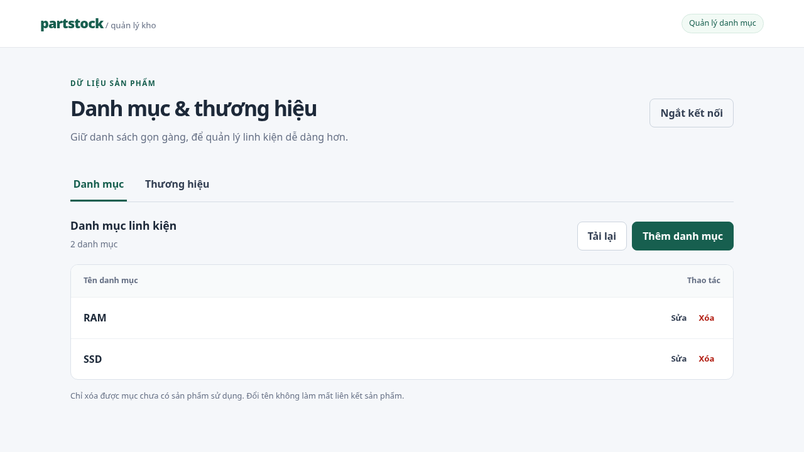

# Bàn demo A — UC01 và Storage

Chuẩn bị ngày 16/11 cho nghiệm thu còn tồn từ 15/11. Đây là kịch bản và bằng chứng kỹ thuật,
chưa phải biên bản buổi nghiệm thu. Owner A; Tuấn review, Hải tái tạo, Khánh rà UI/API.

## UC01 qua giao diện → HTTP → MySQL

Dùng [hướng dẫn frontend](../../frontend/README.md) và [backend](../../backend/README.md).
Không chia sẻ `.env.docker` hoặc token. Chạy demo trên dữ liệu thử của máy mình; không xóa
dữ liệu cần giữ. Test tự động bên dưới dùng schema tạm trên MySQL lab.

1. Mở UI và kết nối bằng mã quản lý local. Chọn Danh mục, xem RAM/SSD nếu đã nạp seed.
2. Tạo một danh mục mới, đổi tên, tải lại để thấy dữ liệu đã lưu. Thử tên rỗng và tên trùng:
   hệ thống phải báo lỗi, không thêm bản ghi.
3. Mở Xóa, chọn Hủy để chứng minh dữ liệu còn nguyên; mở lại và xác nhận Xóa mục chưa dùng.
4. Thử xóa danh mục hoặc hãng đang có sản phẩm: báo đang được sử dụng, giữ dữ liệu.
   Đổi tên vẫn giữ liên kết ID với sản phẩm; integration test đối chiếu SQL thật.
5. Lặp lại với Thương hiệu. Thử tab, bàn phím/Escape, màn hình nhỏ; focus trở về nút mở
   hoặc nút Thêm sau khi dòng bị xóa.
6. Giải thích giới hạn: token local chưa thay hai actor/đăng nhập; chưa có UI miền khác.



[Ảnh màn hình 390 px](evidence/uc01-mobile.png). Ảnh chụp từ browser test với dữ liệu lab,
không chứa token hoặc thông tin người thật.

Từ gốc repo:

```bash
npm test --prefix backend
npm run test:db --prefix backend
node --env-file=.env.docker backend/tests-db/uc02-03.cjs
npm run build --prefix frontend
npm test --prefix frontend
```

Lệnh cuối cần Chromium theo frontend/README. Đã chạy: backend 11/11; integration UC01
và UC02–03 PASS; browser 5/5; frontend build PASS. Môi trường: Node 26.13.0,
MySQL lab 8.4.13; Chromium cài sẵn được chỉ định qua `PLAYWRIGHT_CHROMIUM_EXECUTABLE_PATH`.
Ca trình duyệt gồm lỗi mạng/độ trễ bằng chặn request có chủ đích, còn CRUD/FK dùng API và
DB thật. Không suy diễn từ test quản lý local thành test đủ hai actor.

## Storage & management trên hai DBMS

Chạy và trình bày theo [3-2-storage.md](3-2-storage.md) và
[README lab](../../experiments/storage/README.md). Điều kiện gồm MySQL lab, MongoDB lab rs0
đã khởi tạo; không chạy đồng thời lab khác khi lấy snapshot fsync MongoDB.

```bash
node experiments/storage/run.cjs
```

Giải thích năm pha: rỗng → 1.000 → 5.000 bản ghi → mở rộng mô tả → xóa nửa số bản ghi.
Trước khi nói về dung lượng, chỉ ra kiểm tra giá trị logic PASS ở cả hai hệ. Sau đó phân biệt
kích thước logic, cấp phát và index; DELETE không bảo đảm giảm tương ứng dung lượng cấp phát.
Không lấy hai chỉ số có nghĩa khác nhau để xếp hạng DBMS; fixture lặp dễ nén và một lượt
chính thức không đại diện mọi dữ liệu. Đây không phải benchmark thời gian.

Đã có [kết quả thật ngày 15/11](../../experiments/storage/results-initial.json);
chưa có review Tuấn hoặc lần tái tạo độc lập của Hải. Không ghi kết quả mới nếu chưa chạy lại.
